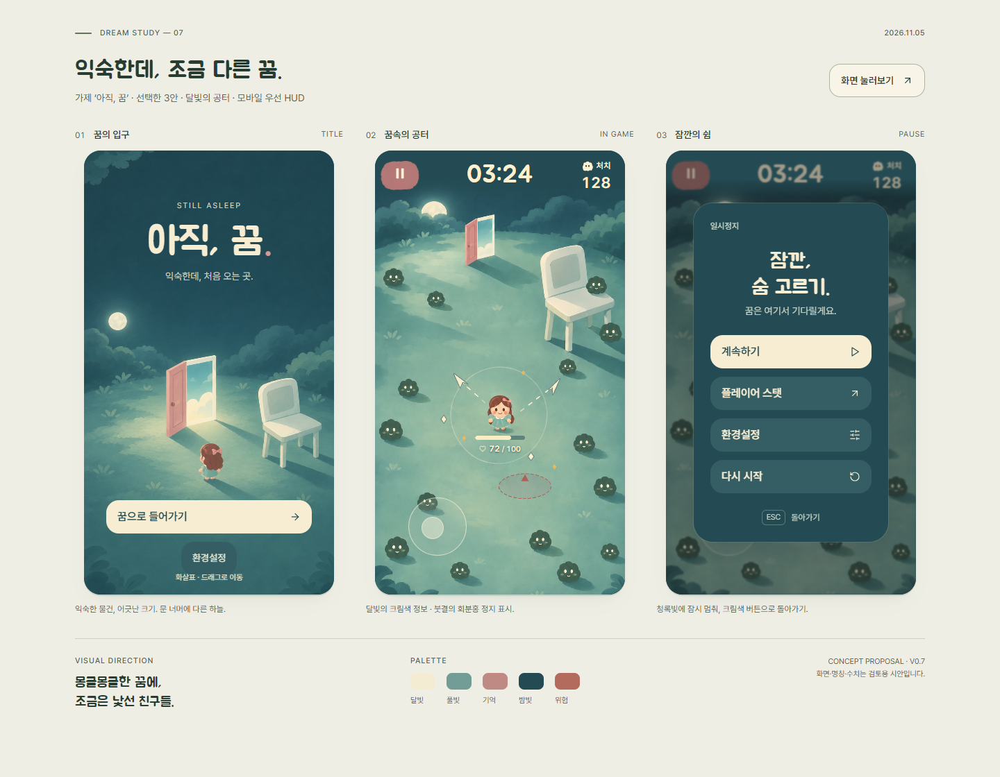

# 꿈속 생존 게임 — 디자인·확장 기준서

버전 1.0 · 2026-11-05 · 기준 시안 v0.7 / 선택안 03 ‘달빛의 공터’

> **게임의 그림체와 세계관 안에서 자연스럽게 만들어진 느낌이 중요하다.**
>
> 새 요소의 판단 기준은 장식의 양이 아니라, 배경·캐릭터·조작부·전투 정보가 같은 세계에서 만들어진 것처럼 보이는가다.

## 1. 이 문서의 역할과 현재 상태

기능, 맵, 적, 효과, UI를 추가할 때 처음 읽는 공통 기준이다. 아트 방향과 모바일 UX는 여기서 판단하고, 구체적인 컴포넌트 수치는 [UI 규격](dream-concept/DESIGN_SYSTEM.md), 실제 전투 판정·이벤트는 [전투 확장 계약](COMBAT_FOUNDATION.md)을 따른다.

| 구분 | 현재 상태 |
| --- | --- |
| 사용자가 선택한 방향 | 익숙하지만 이상한 꿈, 몽환적이고 약간 불안한 분위기, 귀엽고 둥근 표현, 3안 ‘달빛의 공터’ |
| 지정 글꼴·플랫폼 | 주아체 + Pretendard, 모바일 우선, PC도 세로 화면 중심 |
| 시안에 반영된 것 | 청록색 밤 페인팅, 크림색 HUD, 회분홍 정지 면, 타이틀·전투·정지 메뉴 |
| 실제 플레이 구현 | Phaser 게임에 달빛 타이틀·분리 제작한 배경과 배우·HUD·메뉴를 통합했다. [통합 규격과 검증](features/moonlight-integration.md)을 따른다 |
| 아직 확정하지 않은 것 | 정식 게임명, 전체 세계관 서사, 맵 목록·순서, 새 능력·재화·성장·보상 시스템, 제작용 자산 규격 |
| 문서의 확장 제안 | 뒤의 새 맵 예시와 제작 양식은 기획을 돕는 제안이다. 구현된 콘텐츠나 확정 로드맵을 뜻하지 않는다 |

‘아직, 꿈’은 시안의 가제다. ‘공터서바이버’라는 현재 프로젝트 이름을 자동으로 바꾸지 않는다. 최신 사용자 지시가 우선하며, 선택이 바뀌면 이 문서와 관련 규격을 함께 갱신한다. 초기 조사와 폐기된 시안은 현재 기준을 덮어쓰지 않는다.

## 2. 눈으로 비교할 기준 이미지

- **아트 방향의 기준:** [사용자가 선택한 3안 원본](dream-concept/explorations/03-moonlight.png).
- **UI 구현의 기준:** [모바일 전투](../artifacts/dream-combat-mobile-390-v7.png), [320px 화면](../artifacts/dream-combat-mobile-320-v7.png), [안전 영역 모의 화면](../artifacts/dream-combat-mobile-safe-v7.png), [정지 메뉴](../artifacts/dream-pause-mobile-v7.png).
- **재현과 검증:** [미리보기 실행법](dream-concept/README.md), [시각 검토 기록](dream-concept/REHEARSAL.md).
- **외부 참고와 탐색 과정:** [아트 방향 비교](dream-concept/explorations/README.md), [꿈속 콘셉트 조사](DREAM_CONCEPT_RESEARCH.md), [탕탕특공대 HUD 분석](HUD_DETAIL_MOBILE_REVIEW.md).

위 시안의 수치 03:24·128·72/100과 페인팅 속 적·공격은 검토용이다. 시안 이미지는 인물·적을 포함한 정지 장면이다. 실제 게임은 별도로 제작한 `public/art/moonlight/`의 빈 배경·투명 배우를 사용한다. 새 맵의 타일맵·충돌 지형이 완성됐다는 의미는 아니다.

## 3. 계속 유지할 정체성

### 익숙한 장소에 낯선 관계 하나

실제 있을 법한 장소와 물건에서 시작한다. 크기, 거리, 그림자, 공간 연결 중 하나를 어긋나게 해 꿈처럼 느끼게 한다. 첫 장면의 거대한 의자와 다른 하늘로 열리는 문이 그 예다. 모든 물건을 동시에 기괴하게 바꿔 장소를 알아보기 어렵게 만들지 않는다.

귀여움은 둥근 실루엣, 작은 표정, 부드러운 색 덩어리에서 나온다. 약간의 불안은 비어 있는 공간, 어긋난 비율, 예상과 다른 그림자에서 만든다. 현재 방향을 유지할 때 사실적인 잔혹 묘사나 강한 공포 연출을 기본 표현으로 삼지 않는다.

### 부드러운 페인팅을 공유

- 배경·소품·캐릭터·UI용 그림은 같은 붓결, 단순화 수준과 조명 방향을 공유한다.
- 넓고 조용한 색면을 먼저 잡고, 질감은 가장자리와 재질을 설명하는 만큼 사용한다. 작은 화면 전체를 고운 무늬로 채우지 않는다.
- 장식은 화면의 의미와 재료에서 나온다. 그림자·테두리·광택은 실제 형태와 빛을 설명할 때 사용한다.
- 글자와 숫자는 실제 글꼴로 선명하게 표시한다. 그림체를 맞추기 위해 가독성까지 흐리거나 글자를 이미지에 굽지 않는다.

### 캐릭터의 식별점

선택한 3안의 작은 여자 캐릭터가 기준이다. 큰 둥근 머리와 짧은 팔다리, 작은 점눈·볼, 밤색 웨이브 머리, 작은 분홍 리본, 민트 드레스를 유지한다. 전투 중에는 한눈에 위치와 방향을 알아볼 수 있어야 한다.

맵 테마 때문에 머리·얼굴 비율이나 기본 실루엣을 바꾸지 않는다. 큰 흰자·홍채·속눈썹·강한 얼굴 음영을 넣은 이전 인물 방향은 사용자가 선호하지 않았다. 새 포즈·공격·피격도 기본 실루엣과 작은 화면의 식별성을 기준으로 만든다.

## 4. 공통 색의 역할과 맵별 변주

| 역할 | 현재 기준 | 확장 시 사용 |
| --- | --- | --- |
| 밤·조용한 바탕 | `#244B53` | HUD 주변과 메뉴에 안정적인 바탕을 제공한다 |
| 달빛·주 행동 면 | `#F6EDD3` | 중요한 글자·캐릭터의 밝은 부분·주 행동을 연결한다 |
| 전투 HUD 정보 | `#FFF1CF` | 어두운 배경에서 시간과 처치를 빠르게 읽게 한다 |
| 기억·정지의 강조 | `#BF8984` 계열 | 문·정지 면 등의 제한된 강조. 자산은 붓결에 따라 색이 달라진다 |
| 공터·환경 중간색 | `#719D96` 계열 | 이동 공간과 배경의 부드러운 단계를 만든다 |
| 메뉴 보조 면 | `#345E64` | 계속하기보다 낮은 우선순위의 행동을 묶는다 |
| 위험 예고 | `#B36B5E` 계열 | 적의 공격 영역. 형태·경계·타이밍을 함께 사용한다 |

이 색을 모든 맵의 배경에 그대로 복사할 필요는 없다. 맵의 주조색과 광원은 바꿀 수 있지만 **정보의 의미와 강조 순서**는 유지한다. 새 바닥 위에서 크림색 체력이나 위험 예고가 묻히면 배경 명도·채도·패턴을 먼저 조정하고 실제 전투 장면으로 다시 확인한다.

문·의자·달은 현재 맵의 모티프다. 모든 새 맵에 의무적으로 넣지 않는다. 새 테마가 같은 그림체와 감정으로 읽히면 된다.

## 5. 모바일 전투와 정보 위계

| 우선순위 | 정보 | 배치·판단 기준 |
| --- | --- | --- |
| 즉시 생존 | 내 위치, 이동 가능한 곳, 가까운 적, 공격 예고 | 플레이 영역에서 가장 먼저 구분한다. 엄지·전경·효과가 함께 가리지 않게 한다 |
| 내 상태 | 현재/최대 체력 | 캐릭터 바로 아래. 카메라·배경 배율이 바뀌어도 캐릭터를 따라간다 |
| 진행 상황 | 생존 시간, 처치 | 상단 중앙 시간·상단 오른쪽 처치. 내용 길이와 무관하게 시간을 정중앙에 둔다 |
| 중단 | 일시정지 | 상단 왼쪽, 48×48 CSS px 터치 면. 가장자리 장식과 실제 터치 면을 구분한다 |
| 자세한 정보 | 스탯, 설정, 재시작 | 메뉴에서 확인한다. 상시 HUD에 상세 수치를 모두 늘어놓지 않는다 |

HUD의 조용한 상단 영역은 맵 아트에도 포함해 설계한다. 달·간판·나뭇가지처럼 밝거나 윤곽이 강한 물체를 그 아래에 배치한다. 기존에 달과 정지 표시가 작은 화면·안전 영역에서 겹친 문제를 수정한 사례를 반복하지 않는다.

모바일 UI를 PC 화면에서 일괄 축소해 만들지 않는다. 배경·월드의 확대와 UI 배율을 분리한다. 노치와 하단 제스처 영역을 고려하며, 버튼과 글자를 안전 영역 안에 둔다. 세로를 기준으로 설계하되 실제 게임이 지원하는 가로 회전도 호환 확인한다.

## 6. 새 UI·기능을 추가하는 방법

새 기능은 [기능 기획 양식](templates/FEATURE_BRIEF.md)에서 시작한다. 먼저 플레이어가 언제 무엇을 알아야 하고 어떤 행동을 할지 적는다. 정보가 필요한 시점과 위치를 정한 뒤 표현을 만든다.

| 새 정보의 성격 | 우선 검토할 위치 |
| --- | --- |
| 맞거나 피하기 위해 즉시 필요함 | 해당 적·캐릭터·위험 영역 주변의 짧고 분명한 표시 |
| 플레이 중 계속 판단해야 함 | 기존 HUD에서 의미가 맞는 자리. 새 상시 영역은 필요성을 설명한다 |
| 선택 순간에만 필요함 | 해당 선택 화면. 선택의 결과와 돌아가는 경로를 함께 보여준다 |
| 상세 계산·설정·설명임 | 기존 메뉴의 하위 화면 또는 관련 상세 보기 |

상시 숫자·버튼·카드를 늘리는 것을 기본 해법으로 삼지 않는다. 새 표시를 넣었을 때 기존 체력·시간·위험 예고의 우선순위가 뒤집히지 않는지 확인한다. 스킬 슬롯·경험치·상점·재화·맵 선택 등은 이 문서에 등장한다고 해서 추가가 결정된 기능이 아니다.

컴포넌트는 기존 글꼴·간격·색 역할과 상태 표현을 재사용한다. 새 그림이 필요하면 ‘이 세계에서 어떤 재료와 방식으로 그려지는가’를 한 문장으로 설명할 수 있어야 한다. 기존 정지 면을 복사해 모든 기능을 분홍 버튼으로 만드는 식의 반복도 피한다.

새 행동에는 기본·누름·포커스·사용 불가·선택/열림 상태 중 실제로 필요한 상태를 정의한다. 색만으로 상태를 전달하지 않는다. 메뉴 문구는 짧고 행동을 설명해야 하며, 구현상의 설명은 플레이어 화면에 넣지 않는다.

실제 기능을 연결할 때는 전투 정지와 복귀를 함께 구현한다. 메뉴·하위 화면에서는 공격, 적 생성, 지연 효과, 시간 조건이 함께 멈춰야 한다. 이동 중 메뉴 진입, 포인터 취소, 화면 이탈, 회전 뒤에는 기존 이동 입력을 해제한다. 자세한 판정과 연결 방식은 [실제 게임 README](../README.md)와 [전투 확장 계약](COMBAT_FOUNDATION.md)을 따른다.

## 7. 새 맵을 추가하는 방법

[맵 기획 양식](templates/MAP_BRIEF.md)을 복사한다. ‘익숙한 장소 + 꿈의 어긋남 + 광원 + 전투 공간’ 네 가지를 먼저 정한다. 새 맵의 새로움은 장소와 공간 경험에서 만들고, 캐릭터·HUD의 정체성은 유지한다.

| 맵마다 바꿀 수 있는 것 | 계속 유지할 것 |
| --- | --- |
| 장소, 시간대, 날씨, 바닥 재질, 주조색 | 부드러운 페인팅, 둥근 형태, 절제된 질감 |
| 크기·거리·연결 중 선택한 꿈의 어긋남 | 익숙하지만 이상한 분위기, 과도한 공포를 피하는 귀여움 |
| 대표 소품, 원경·전경, 광원과 그림자 | 플레이어·적·위험 예고를 먼저 읽는 전투 위계 |
| 적의 테마와 소품을 활용한 표현 | 내 캐릭터의 비율·식별점, 피해·충돌의 일관된 피드백 |
| 별도 기획한 지형·기믹 | HUD 위치·글꼴·터치 규격, 메뉴의 공통 사용법 |

장식·통과 가능한 물체·실제 장애물·위험 영역을 구분해 기록한다. 큰 의자처럼 눈에 띄는 소품이 실제 충돌을 가진다면 보이는 형태와 충돌 경계가 납득되게 맞아야 한다. 전경 가림, 그림자, 바닥 무늬가 공격 예고나 통로처럼 잘못 읽히지 않게 한다.

맵에 고유 기믹이 있으면 **진입 신호 → 위험/선택을 읽는 시간 → 실제 판정 → 해제/보상**을 한 흐름으로 설계한다. 장식만으로 플레이어가 기믹을 이해했다고 가정하지 않는다. 처음 보는 사람이 예측할 수 있는지와 이동 공간을 막는지를 실제 플레이에서 확인한다.

맵 예시 — 아래 두 가지는 확정된 추가 맵이 아니다.

| 제안 | 장소와 어긋남 | 같은 게임으로 연결하는 표현 | 먼저 확인할 점 |
| --- | --- | --- | --- |
| 끝나지 않는 복도 | 익숙한 복도에 같은 문이 다른 거리로 반복됨 | 청록 원경, 크림색 조명, 둥근 회분홍 문, 동일한 페인팅 | 문·창틀이 상단 HUD를 가리지 않는가, 긴 바닥선이 공격 방향처럼 보이지 않는가 |
| 잠든 수영장 | 비어 있는 수영장 바닥에 하늘이 비침 | 민트·푸른 중간색, 크림색 반사광, 절제된 그림자 | 반사가 체력·탄환·위험 예고를 숨기지 않는가, 물과 통과 불가 영역을 구분할 수 있는가 |

각 맵은 낮은 밀도의 장면, 적·공격이 많은 장면, 정지 메뉴가 열린 장면을 같은 모바일 화면비로 만들어 비교한다. 멋진 배경 단독 이미지 한 장으로 전투 가독성을 판정하지 않는다.

## 8. 적·스킬·효과가 추가될 때

- 적은 작은 크기의 실루엣과 이동/공격 신호로 역할을 구분한다. 색만 달리한 적을 서로 다른 위험으로 구분하도록 요구하지 않는다.
- 플레이어와 적의 공격, 공격 예고와 실제 타격을 구분한다. 범위·지속 시간·피해 판정은 효과의 모양과 연결해야 한다.
- 피격·사망·획득은 결과를 읽게 하는 만큼 표현한다. 반짝임·입자·화면 흔들림을 기능의 보상처럼 무조건 더하지 않는다.
- 효과가 겹쳐도 플레이어·체력·다음 위험을 볼 수 있어야 한다. 동작 감소 설정에서도 필수 신호는 남긴다.
- 게임 판정과 연출을 분리한다. 공통 피해·처치·흡혈·스탯·전투 이벤트를 우회하는 개별 구현을 만들지 않는다. 테스트 대상은 [전투 확장 계약](COMBAT_FOUNDATION.md)에서 고른다.

## 9. 자산과 실제 구현으로 넘기는 기준

현재 전체 페인팅은 **장면의 모양을 검토하는 자료**다. 실제 맵은 바닥·원경·가림 소품·충돌 지형·캐릭터·적·공격/효과·UI를 구분해 제작한다. 장면 한 장을 그대로 가져와 장애물이나 적이 동작하는 것처럼 취급하지 않는다.

| 구분 | 자산/정의에 남길 정보 |
| --- | --- |
| 맵 배경·소품 | 원근, 광원, 사용 배율, 기준 좌표, 반복 가능 여부, 가림 순서 |
| 실제 지형 | 통과/충돌/위험 구분, 판정 영역, 출현·이동 공간, 시각 경계 |
| 캐릭터·적 | 기준 크기와 발/중심 앵커, 충돌체, 필요한 동작과 상태 |
| 효과 | 소속, 예고/판정/해제 구간, 실제 범위, 가림 우선순위, 동작 감소 표현 |
| UI 그림 | 투명 배경, 여백과 확장 방식, 표시 크기, 실제 터치 영역. 글자·수치는 별도 구현 |

새 기능·맵은 데이터와 판정, 그리기, UI의 책임을 구분한다. 장면 아트 선택 때문에 현재 게임 엔진이나 전투 규칙을 바꾸지 않는다. 제작용 이미지 크기·프레임 수·용량·성능 예산은 실제 구현과 기기 측정에 맞춰 정하고 작업 문서에 남긴다. 시안 배경의 910×1728은 모든 게임 자산의 표준이 아니다.

이미지 생성 도구를 쓰면 선택된 시안을 스타일/캐릭터 참조로 지정하고, 바꿀 것과 유지할 것을 나누어 적는다. 프롬프트·참조 파일·출력 경로를 기록한다. 기존 [자산 프롬프트](dream-concept/assets/prompts.json)를 시작점으로 쓸 수 있지만, 새 맵에는 불필요한 문·의자·달을 자동으로 복제하지 않는다.

## 10. 추가 작업의 완료 확인

새 기능·맵의 작업 문서에 해당 항목의 결과를 남긴다. 적용하지 않는 항목은 이유를 짧게 적고, 확인하지 못한 것은 통과로 표시하지 않는다.

- [ ] 무엇이 새로워졌는지 한 문장으로 설명할 수 있고 기존 규칙을 바꾸는 부분을 기록했다.
- [ ] 선택한 3안 및 현재 캐릭터와 나란히 봐도 같은 게임의 아트로 읽힌다.
- [ ] 새 배경·효과 위에서 플레이어, 체력, 적, 다음 위험을 구분한다.
- [ ] 시간은 정중앙이며 상단·하단 안전 영역과 엄지 가림을 확인했다.
- [ ] 320×568·360×640·390×844·412×915에서 잘림·겹침·타깃 축소가 없다. PC 세로와 지원하는 가로 844×390도 확인했다.
- [ ] 버튼과 메뉴의 진입·계속하기·뒤로가기·재시작, 이동 입력 해제와 전투 전체 정지를 확인했다.
- [ ] 새 판정·효과에 맞는 테스트와 빌드를 수행하고 실패·제약을 기록했다.
- [ ] 변경된 내용과 연결되는 문서·이미지·데이터를 갱신했다. 실제 기기/전투 밀집도/성능을 확인한 범위도 구분했다.

문서만 변경한 작업에는 게임 실행 테스트를 추가하지 않는다. UI 정지 시안의 검사나 빌드 성공을 실제 폰 입력·재미·밸런스·장시간 성능 검증으로 표현하지 않는다.

## 11. 결정 이력과 문서 관리

| 날짜 | 결정 | 후속 작업에 미치는 영향 |
| --- | --- | --- |
| 2026-11-05 | 꿈속, 익숙하지만 이상하고 조금 불안한 분위기 | 낯선 관계를 가진 익숙한 장소에서 맵을 시작한다 |
| 2026-11-05 | 귀엽고 둥근 표현, 주아체 + Pretendard | 과한 얼굴 디테일과 가는 장식체를 기본으로 사용하지 않는다 |
| 2026-11-05 | 탕탕특공대의 모바일 정보 배치·맥락에 맞는 디테일 참고 | 정지·시간·처치·체력의 역할을 유지하며 표면 장식보다 공통 아트를 우선한다 |
| 2026-11-05 | 물리적인 창틀·기둥을 덧붙인 시안 거절 | 자연스럽지 않은 형태를 장식과 접합 설명으로 정당화하지 않는다 |
| 2026-11-05 | 세 방향 중 3안 ‘달빛의 공터’ 선택 | 현재 아트·UI 기준. 종이 과슈안과 직물안은 대안 기록이다 |
| 2026-11-05 | 기능·맵 확장을 위한 기준 문서 요청 | 이 문서와 아래 양식을 확장의 시작점으로 사용한다 |

새 결정이 생기면 날짜·결정·영향을 이 표에 추가한다. 아트/세계관은 이 문서, 컴포넌트 수치는 [UI 규격](dream-concept/DESIGN_SYSTEM.md), 게임 판정은 [전투 확장 계약](COMBAT_FOUNDATION.md), 실제 동작·실행법은 [프로젝트 README](../README.md)를 함께 갱신한다. 이전 시안의 기록은 이력을 남기되 현행 규칙과 섞지 않는다.
