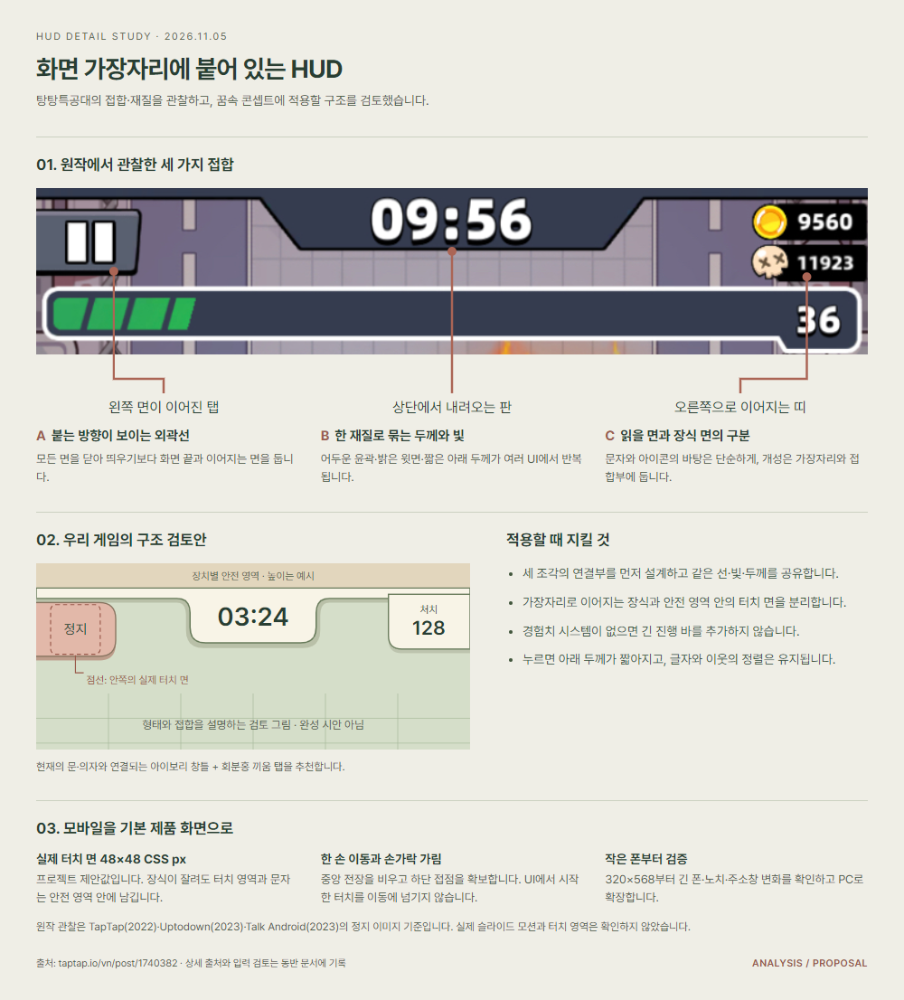

# 탕탕특공대 HUD 디테일과 모바일 우선 설계 검토

작성일: 2026-11-05. 상태: **분석·적용 제안**. 실제 게임과 현재 시안의 코드는 변경하지 않았다.

## 판단

탕탕특공대에서 가져올 핵심은 **화면 가장자리에 붙는 방식, 공통 재질, 서로 맞물리는 외곽선, 행동에 맞는 피드백**이다. 현재 시안은 위치·색·둥근 모서리를 맞췄지만 정지·시간·처치가 각각 독립된 캡슐로 놓여 있다. 다음 시안에서는 이 세 요소를 꿈속 공간의 창틀에 연결된 한 구조로 다루는 것이 좋다.

**모바일 세로 화면을 제품의 기본 화면으로 설계한다.** PC에서 만든 화면을 줄여 모바일에 넣는 방식 대신, 실제 휴대폰의 안전 영역·엄지 조작·손가락 가림·브라우저 높이 변화를 먼저 검토한다.

## 근거와 확인 범위

| 자료 | 확인 내용 |
| --- | --- |
| [TapTap 플레이 스크린샷](https://www.taptap.io/vn/post/1740382), 2022-09-25 게시 | 좌측 정지 탭, 상단 타이머 판, 우측 카운터, 경험치 게이지와 레벨 끝단, 인물 아래 체력 |
| [Uptodown 화면 비교](https://blog.en.uptodown.com/survivor-io-requirements-and-how-to-play/), 2023-04-13 게시 | 일반 전투·보스 경고·스킬 선택에서 이어지는 프레임과 색의 역할 |
| [Talk Android 정지 화면](https://www.talkandroid.com/24372-survivor-io-ultimate-game-guide-with-tips-2023/), 2023-08-23 게시 | 노란 제목 띠·망점 질감·스킬 판·하단 재개 버튼·좌우 가장자리 보조 탭 |

공개된 과거 버전의 정지 이미지를 관찰했다. 최신 버전 전체나 실제 입력 영역·등장 애니메이션을 직접 확인한 결과는 아니다. ‘옆에서 나와 있는’ 외형은 확인할 수 있지만, 실제로 옆에서 슬라이드해 등장하는지는 이 자료만으로 확정하지 않는다. 스크린샷 위쪽의 검은 여백도 게임의 노치 대응으로 단정하지 않는다.

## 1. 형태와 접합을 어떻게 설계했는가

| 요소 | 화면에서 관찰한 디테일 | 읽히는 효과 | 우리 시안에 적용할 제안 |
| --- | --- | --- | --- |
| 정지 버튼 | 왼쪽 면이 화면 가장자리와 이어지고 오른쪽 끝이 노출된 탭이다. 어두운 외곽선, 밝은 윗면과 아래 두께가 있다. | 가장자리에서 나온 조작부라는 소속과 누를 수 있는 면을 동시에 표현한다. | 왼쪽 창틀에 끼운 회분홍 탭. 바깥쪽은 가장자리에 연결하고 안쪽 끝만 둥글게 닫는다. |
| 타이머 | 상단에 닿는 넓은 판에서 양쪽 어깨가 사선으로 내려온다. 숫자가 안쪽 면에 앉는다. | 상단 프레임에 매달린 중심 계기로 읽힌다. | 아이보리 창틀에서 내려온 작은 시간 표찰. 가로 중앙을 고정하고 아래 모서리를 부드럽게 만든다. |
| 우측 카운터 | 화면 우측으로 이어지는 짙은 띠와 그 앞에 걸친 아이콘이 보인다. | 작은 수치가 프레임에 속하면서도 아이콘을 먼저 인식하게 한다. | 오른쪽 창틀에 붙은 얇은 기록 띠. 처치 정보만 표시하고 수치 너비를 고정한다. |
| 경험치·레벨 | 긴 트랙의 끝이 아래로 내려와 레벨 숫자를 감싼다. 흰 외곽선과 분절된 채움이 있다. | 막대와 레벨이 한 덩어리로 읽힌다. | **끝단을 맞물리는 형태 원리만 참고한다.** 현재 없는 경험치·레벨 시스템이나 의미 없는 긴 게이지를 추가하지 않는다. |
| 정지·선택 제목 | 노란 띠의 잘린 모서리, 밝은 테두리, 어두운 바닥 면, 망점 무늬가 반복된다. | 서로 다른 화면에서도 같은 만화적 재질과 중요도 규칙을 유지한다. | 타이틀·전투 HUD·정지 메뉴에 동일한 아이보리 면·회분홍 끼움부·짙은 녹색 아이콘을 사용한다. |
| 정지 화면 보조 조작 | 통계·홈·소리 버튼도 좌우 화면 끝에 붙은 탭 형태다. 재개는 아래쪽의 강한 노란 버튼이다. | 보조 조작은 주변부, 다음 주 행동은 중앙 아래에 자리한다. | 정지 메뉴의 계속하기를 하단에서 쉽게 누르게 하고 스탯·설정·재시작의 강조를 낮춘다. 실제 기능이 없는 아이콘은 추가하지 않는다. |
| 체력·조이스틱 | 체력은 인물에 붙고 조이스틱은 하단의 반투명 원으로 나타난다. | 생존 정보는 인물 시선 안에, 조작 표시는 손가락 근처에 둔다. | 인물 아래 체력 유지. 이동 조작은 첫 접점에 생기는 방식부터 검토한다. 원작의 조이스틱 고정·동적 여부는 정지 이미지로 단정하지 않는다. |

위 효과는 관찰을 바탕으로 한 디자인 해석이다. HUD는 화면에 고정된 조작·정보 층으로 유지하되, 배경 오브젝트와 선·색·광원 규칙을 공유해 세계의 일부처럼 느껴지게 한다.

## 2. 재질을 통일하는 규칙

우리 배경의 문과 의자에서 **연한 칠을 한 아이보리 창틀**을 UI의 공통 재질로 가져오는 방향을 추천한다.

- 바깥 윤곽: 짙은 녹색 계열. 작은 화면에서도 실루엣을 구분할 수 있게 한다.
- 윗면: 얇고 밝은 하이라이트. 같은 광원 방향을 쓴다.
- 아랫면: 짧은 두께와 접촉 그림자. 전장 전체를 흐리게 덮는 그림자를 피한다.
- 접합부: 회분홍 탭이나 짧은 끼움 면. 어디에 연결됐는지 보이게 한다.
- 곡률: 정지 탭·중앙 판·기록 띠는 각각의 붙는 방향에 맞게 다르게 만든다. 둥근 정도와 선의 무게는 같은 계열을 쓴다.
- 숫자·문구: 주아체 제목·타이머, Pretendard 본문·버튼·수치를 유지한다. 텍스트 영역에는 강한 질감과 그림을 넣지 않는다.

360 CSS px 너비에서 바깥선 약 1.5–2px, 하이라이트 약 1px, 아래 두께 약 2px를 **첫 시안의 후보**로 비교할 수 있다. 원작의 실제 UI 규격을 측정한 값은 아니다.

경험치 트랙을 삭제한 자리에 다른 가짜 진행 바를 넣지 않는다. 상부 연결부는 얕게 두고 실제 전장 면적과 적의 접근을 확인할 공간을 확보한다.

## 3. 모바일 우선 UI·UX 기준

### 가장자리에 붙은 외형과 안전한 터치를 분리한다

장식 면은 화면 끝까지 이어져도 된다. **아이콘·문자와 실제 터치 영역은 안전 영역 안에 둔다.** 웹에서는 `env(safe-area-inset-*)`로 장치별 여백을 반영하고 브라우저 높이 변화에도 하단 조작이 잘리지 않게 한다. ([MDN](https://developer.mozilla.org/en-US/docs/Web/CSS/Reference/Values/env))

이 웹 게임의 제품 기준은 주요 컨트롤 **48×48 CSS px 이상**, 조작부 사이 간격 **8px 이상**을 우선안으로 잡는다. 이 값은 프로젝트의 설계 제안이다. Apple의 44×44pt, Android의 48×48dp 권장은 각 플랫폼의 논리 단위이며 CSS px와 동일한 수치 체계라고 주장하지 않는다. WCAG 2.2 AA의 최소 타깃 기준은 예외 조항과 함께 24×24 CSS px다. ([Apple](https://developer.apple.com/design/human-interface-guidelines/buttons?changes=latest_1), [Android](https://developer.android.com/guide/topics/ui/accessibility/apps), [W3C](https://www.w3.org/WAI/WCAG22/Understanding/target-size-minimum.html))

### 한 손 조작과 시야를 먼저 설계한다

| 구역 | 역할 | 설계 기준 |
| --- | --- | --- |
| 상단 가장자리 | 정지·시간·처치 | 변화가 적은 위치. 정지는 드물게 누르는 조작이므로 상단 위치를 유지하되 충분한 터치 면을 확보한다. |
| 인물 주변과 전장 중앙 | 회피·적·공격 예고·체력 | 상시 메뉴와 장식을 넣지 않는다. 위험 신호가 배경보다 먼저 읽혀야 한다. |
| 하단과 엄지 접점 주변 | 이동 | 오른손·왼손을 모두 고려한다. 현재 손가락에 가려진 영역에 생존 판단에 필요한 고정 정보를 놓지 않는다. |
| 정지·선택 화면 하단 | 재개·확정 | 한 손으로 누를 수 있는 주요 행동을 배치한다. 화면 아래 시스템 제스처 영역과 분리한다. |

엄지 가림 영역의 위치와 크기는 사람·기기에 따라 달라진다. 고정된 ‘모든 사용자의 엄지 지도’를 전제하지 않고 실제 기기로 확인한다. 자동 공격을 유지하며 일반 전투에 불필요한 공격 버튼을 늘리지 않는다.

### 제스처 소유권을 명확히 한다

1. HUD에서 시작한 접점은 이동 입력으로 전달하지 않는다.
2. 전장에서 시작한 이동은 포인터를 캡처하고 손가락이 UI 위로 지나가도 다른 버튼을 실행하지 않는다.
3. 정지·탭 이탈·포인터 취소·회전 시 눌린 이동을 해제한다.
4. 메뉴를 열면 전투와 관련 타이머·적·탄환을 함께 정지한다.
5. 계속하기 뒤의 버튼 탭이 이동 입력으로 이어지지 않게 하고 새 이동 입력으로 재개한다.
6. 배경 탭만으로 실수로 재개하지 않도록 한다. 호버·길게 누르기 없이 모든 주요 기능을 쓸 수 있게 한다.

### 반응형의 기본 순서를 바꾼다

- 기본: 모바일 세로에서 게임 화면이 가용 뷰포트를 채운다. 전장과 HUD를 별도로 배치해 글자·터치 면이 전장 확대율에 따라 줄지 않게 한다.
- 비교용 보드의 세 화면과 360×640 고정 시안은 검토 도구다. 실제 모바일 UX를 검증한 결과로 취급하지 않는다.
- 작은 폰·긴 폰·노치·하단 홈 표시·주소창 확장/축소를 먼저 확인한다.
- PC는 같은 모바일 HUD를 세로 게임 영역에 표시한다. 추가 대시보드형 정보 패널을 만들지 않는다.
- 가로 화면은 보조 환경으로 확인한다. 세로 컨트롤을 통째로 축소하지 않는다.
- 기본 플레이에는 페이지 스크롤을 만들지 않는다. 긴 스탯·설정은 패널 안에서 스크롤하고 복귀 조작을 유지한다.

### 누르는 느낌도 재질의 일부로 설계한다

정지 탭의 누름 상태에서는 아래 두께와 접촉 그림자가 짧아지게 한다. 해제 시 원래 면으로 돌아온다. 아이콘과 이웃 요소의 위치·정렬은 흔들리지 않아야 한다. 누름 취소도 같은 규칙을 쓴다.

짧은 80–120ms 입력 피드백, 160–220ms 패널 전환은 시안에서 비교할 **후보값**이다. 원작의 관찰된 타이밍이 아니다. 자동으로 흔들리는 HUD나 지속적인 반짝임은 피하고 동작 감소 환경에서도 상태를 읽을 수 있게 한다.

일반 문자는 4.5:1 대비를 기준으로 확인하고 큰 글자는 해당 조건에서 3:1을 적용한다. 색만으로 위험·선택·비활성을 구분하지 않는다. 작은 화면을 맞추기 위해 본문 글자를 축소하지 않는다. ([W3C 대비 기준](https://www.w3.org/WAI/WCAG22/Understanding/contrast-minimum.html))

## 4. 다음 시안에서 검토할 우선순위

| 순서 | 검토 항목 | 확인할 결과 |
| --- | --- | --- |
| 1 | 정지 탭·시간 판·기록 띠의 접합 | 세 요소가 같은 창틀에 붙어 읽히고 각 글자 영역은 서로 충돌하지 않는다. |
| 2 | 실제 폰 뷰포트와 안전 영역 | 시각적 끝단은 가장자리에 붙고 48px 터치 면과 아이콘은 안전 영역 안에 남는다. |
| 3 | 누름·정지·복귀·취소 | 탭의 재질 피드백과 실제 상태가 맞고 이동 입력이 메뉴로 새지 않는다. |
| 4 | 인물 주변 체력·엄지 가림 | 밀집한 전투와 양손 조건에서도 생존 정보가 보인다. |
| 5 | 정지 메뉴의 공통 재질 | HUD와 메뉴의 선·색·두께가 이어지고 계속하기를 빠르게 찾는다. |

처음에는 **전투 HUD 한 화면의 접합과 입력**부터 검토한다. 캐릭터·전체 배경·게임 규칙은 이번 변경의 대상으로 넓히지 않는다.

## 5. 모바일 검증 계획

- 크기: 320×568, 360×640, 390×844, 412×915 CSS px. 큰 화면·가로 844×390은 후순위 호환 확인.
- 장치: iOS Safari와 Android Chrome 실제 기기에서 한 손·왼손·오른손 이동, 노치·제스처 바, 주소창 변화.
- 조작: 가장자리 탭, 이동 중 메뉴 접근, 메뉴 위에서 시작한 드래그, 손가락이 버튼을 통과하는 경우, `pointercancel`, 탭 이탈, 회전, 연속 누름.
- 화면: 적과 공격 효과가 많은 장면에서도 시간·체력·위험 예고를 판독할 수 있는지 확인한다.
- 접근성: 메뉴 텍스트 확대, 포커스와 명확한 조작 이름, 동작 감소. 장식 면의 모양이 클릭 영역을 잘라내지 않는지 확인한다.

## 6. v0.5 시안 적용

이 분석 이후 사용자의 적용 요청에 따라 [v0.5 모바일 전투 시안](dream-concept/README.md)에 창틀·좌측 정지 탭·중앙 시간 판·우측 기록 띠를 구현했다. 안전 영역, 고정 크기의 UI와 별도 배경 확대, 정지 누름 상태를 포함한다. 네 가지 세로 뷰포트와 안전 영역 모의 값, 메뉴 진입·복귀를 Chrome에서 확인했다. [검증 기록](../artifacts/dream-mobile-checks-v5.json).

실제 게임에는 아직 적용하지 않았다. 실제 폰 Safari·Chrome, 이동 입력과 메뉴 사이의 제스처 중재, `pointercancel`, 전투 효과 밀집도·성능은 후속 검증 대상이다.
