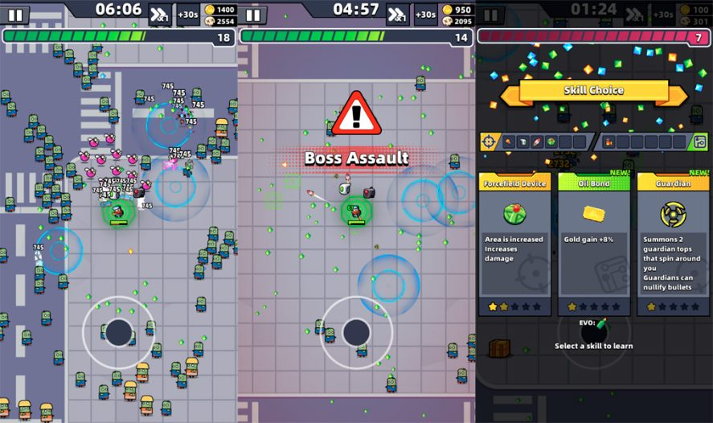
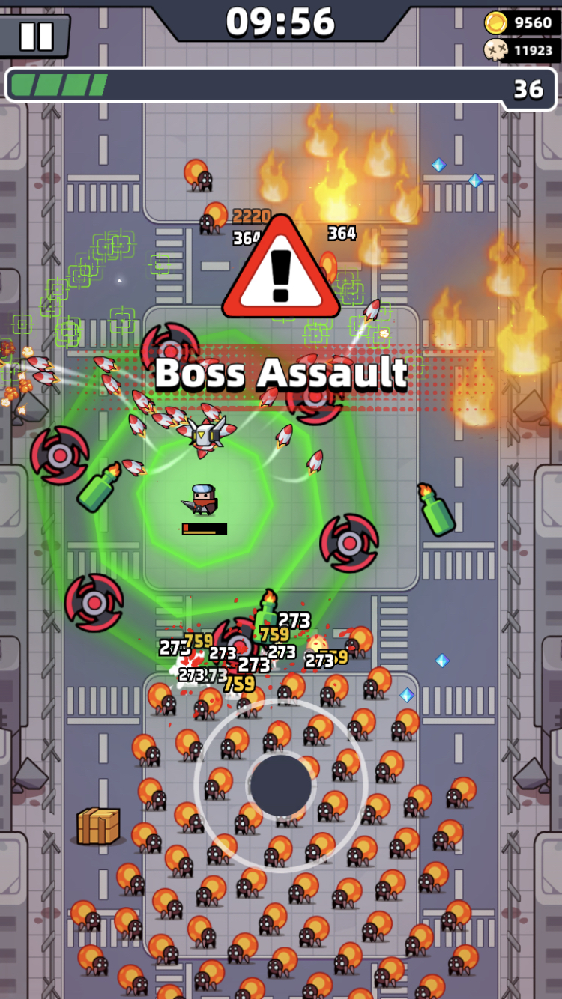

# 탕탕특공대 HUD 분석

작성일: 2026-11-05

후속 검토: [프레임 접합·재질 디테일과 모바일 우선 설계](HUD_DETAIL_MOBILE_REVIEW.md). 정지 탭·타이머 판·기록 띠가 가장자리와 이어지는 방식과 실제 모바일 입력·안전 영역을 상세히 다룬다.

## 분석 범위

공개된 탕탕특공대(Survivor.io) 플레이 스크린샷을 대상으로 HUD의 배치, 정보 우선순위, 시각 표현과 가독성을 분석했다. 직접 플레이하거나 최신 버전의 전체 UI를 검증한 결과는 아니다. 아래의 설계 의도와 개선 방향은 화면 관찰을 바탕으로 한 해석이다.

이 문서는 참고 게임 분석 기록이다. 공터서바이버의 기존 HUD 요구사항이나 구현 결정을 변경하지 않는다.

## 핵심 구조

**상단에는 진행 정보, 캐릭터 주변에는 생존 정보, 하단에는 이동 조작을 배치한다.**

전투 중에는 캐릭터와 적의 움직임을 보면서 체력을 확인하고, 진행 상황이 궁금할 때 상단의 시간과 경험치를 확인하는 구조다. 스킬 선택은 전장을 어둡게 덮는 별도 화면으로 표시한다.

## HUD 요소별 분석

| 요소 | 관찰한 위치와 표현 | 역할과 설계 해석 |
| --- | --- | --- |
| 일시정지 | 좌측 상단의 큰 아이콘 | 고정 위치에서 전투를 멈추는 진입점을 제공한다. |
| 생존 시간 | 상단 중앙의 굵은 흰색 숫자 | 전투 진행을 빠르게 확인하는 기준점이다. |
| 코인·처치 수 | 우측 상단의 아이콘과 숫자 | 누적 정보를 작은 영역에 묶어 전장의 점유를 줄인다. |
| 경험치·레벨 | 상단을 가로지르는 긴 게이지와 오른쪽 레벨 숫자 | 다음 성장까지의 진행률을 넓은 면적으로 전달한다. |
| 체력 | 캐릭터 바로 아래의 짧은 바 | 이동과 회피 중 캐릭터를 보는 시선 안에서 확인할 수 있다. |
| 이동 조이스틱 | 하단의 반투명 원 | 조작 위치를 보여주면서 배경도 일부 드러낸다. 고정형·동적 배치 여부는 정지 이미지로 확정할 수 없다. |
| 보스 등장 경고 | 중앙의 빨간 경고 표식과 큰 문구 | 전투 상황의 변화를 강하게 알린다. |
| 스킬 선택 | 어두운 배경 위의 3개 카드 | 전투와 선택을 시각적으로 구분하고 옵션을 나란히 비교하게 한다. |

**상단의 긴 녹색 바는 체력이 아니라 경험치 게이지다.** 체력은 캐릭터 근처, 경험치는 화면 상단에 배치해 당장의 생존과 다음 성장을 서로 다른 위치에서 읽게 한다.

## 정보 우선순위

| 확인 상황 | 주요 정보 | 시선의 위치 |
| --- | --- | --- |
| 이동·회피·생존 판단 | 캐릭터, 적, 투사체, 체력 | 전장과 캐릭터 주변 |
| 진행 상황 확인 | 생존 시간, 경험치, 레벨 | 상단 중앙과 가로 게이지 |
| 누적 성과 확인 | 코인, 처치 수 | 우측 상단 |
| 전투 변화 인지 | 보스 경고 | 화면 중앙의 일시적 강조 |
| 성장 선택 | 스킬 설명, 별 등급, 보유 스킬 아이콘 | 스킬 선택 오버레이 |

상시 표시 정보는 가장자리로 보내고, 보스 경고와 성장 선택처럼 상황에 따라 중요한 정보만 중앙에 표시하는 방식이다.

## 시각 표현

- **짙은 남색 패널과 굵은 흰색 글자:** 복잡한 전장 위에서도 시간과 수치를 분리해 읽게 한다.
- **두꺼운 테두리와 글자 외곽선:** 바닥 무늬, 적, 불꽃과 UI의 경계를 구분한다.
- **색상별 강조:** 경험치에는 녹색, 보스 경고에는 빨간색, 스킬 선택 제목에는 노란색을 사용한다.
- **아이콘과 숫자의 결합:** 재화와 처치 정보를 긴 설명 없이 표시한다.
- **반투명 조작부:** 하단 조작 영역에서 전장이 일부 보이게 한다. 다만 손가락에 의한 가림은 스크린샷만으로 평가할 수 없다.

## 가독성의 약점

| 관찰 | 예상되는 영향 | 개선 방향 |
| --- | --- | --- |
| 캐릭터 아래 체력 바가 작고 주변 녹색 효과가 강하다. | 전투가 복잡할 때 남은 체력을 빠르게 읽기 어렵다. | 배경·테두리 대비를 높이고 위험 상태를 색과 형태로 함께 표시한다. |
| 보스 경고가 중앙의 넓은 영역을 차지한다. | 경고가 뜬 순간 적과 투사체 일부를 가린다. | 경고의 크기와 노출 시간을 실제 플레이에서 조정한다. 정지 이미지로 지속 시간은 판단할 수 없다. |
| 적 위에 대미지 숫자가 밀집한다. | 공격 성과는 강조되지만 적의 윤곽과 회피 경로가 흐려진다. | 표시 빈도, 숫자 겹침, 유지 시간을 조절하고 위험 예고의 가독성을 확보한다. |

## 공터서바이버에 참고할 점

1. **시간은 고정 위치에서 읽게 한다.** 전투 중 숫자를 찾는 시선 이동을 줄인다.
2. **체력의 가독성을 우선한다.** 캐릭터 근처 배치는 참고할 수 있지만, 기존 상단 체력 배치를 바꿀지는 별도 검토한다.
3. **전장 중앙을 상시 UI로 채우지 않는다.** 보스 경고처럼 순간적으로 중요한 정보에만 중앙을 사용한다.
4. **대미지 숫자와 효과가 위험 정보를 덮지 않게 한다.** 적의 윤곽과 공격 예고를 읽을 수 있어야 한다.
5. **현재 게임에 필요한 정보만 가져온다.** 경험치 바, 코인, 스킬 슬롯은 해당 시스템이 필요할 때 별도로 판단한다.

기존 공터서바이버의 방향과 구현 기록은 [HUD 개선 검토](HUD_REVIEW.md), [HUD 구현 검증](HUD_IMPLEMENTATION.md)을 참고한다.

## 참고 이미지와 출처

### 일반 전투·보스 경고·스킬 선택

[출처: Uptodown — Survivor.io: requirements and how to play](https://blog.en.uptodown.com/survivor-io-requirements-and-how-to-play/)

### 전투 효과가 밀집한 장면

[출처: TapTap — Survivor.io review](https://www.taptap.io/vn/post/1740382)

이미지는 공개 원문에서 수집한 참고 자료이며 각 원출처의 권리를 따른다.
