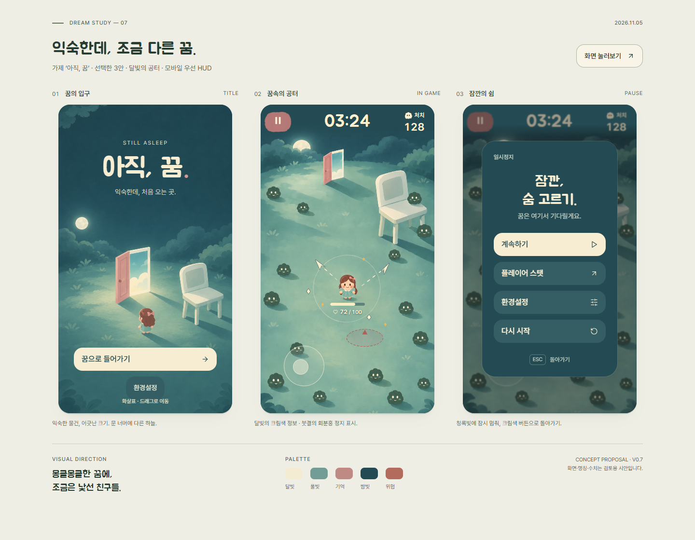
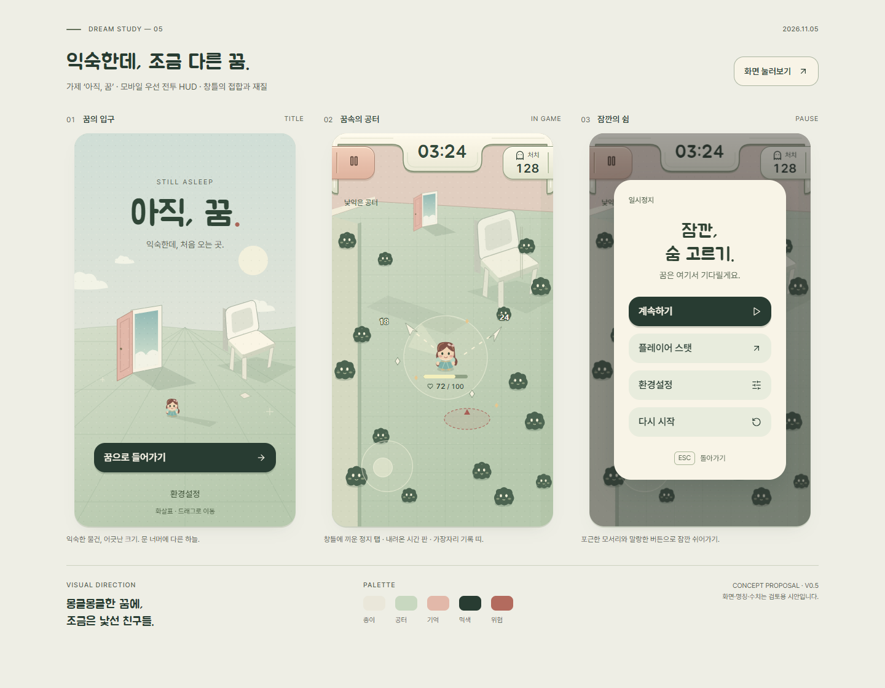
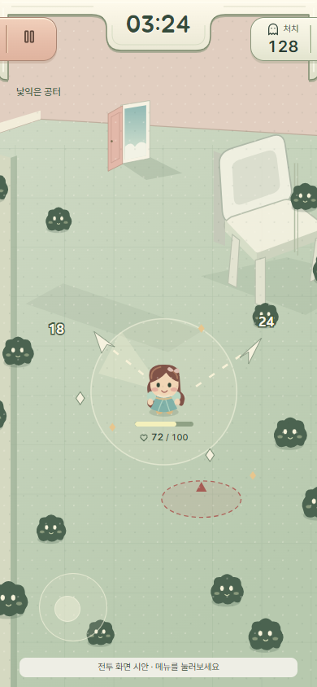

# 아직, 꿈 — 화면 콘셉트 v0.7

> 후속 적용: 선택한 그림체를 실제 Phaser 게임에 연결했다. [실제 플레이 통합](../features/moonlight-integration.md)을 참고한다. 이 디렉터리의 React 화면과 아래 캡처 기록은 정지 시안으로 보존한다.

후속 기능·맵의 공통 기준은 **[디자인·확장 기준서](../DESIGN_BIBLE.md)**, 현행 수치와 상태는 [UI 컴포넌트 규격](DESIGN_SYSTEM.md)을 따른다. 아래의 이전 구현 기록은 참고 이력이며 현재 규격으로 가져오지 않는다.

사용자가 [3안 ‘달빛의 공터’](explorations/03-moonlight.png)를 선택했다. ‘게임의 그림체와 세계관 안에서 자연스럽게 만들어진 느낌’을 기준으로 청록색 밤·크림색 달빛·회분홍 문과 정지 표시를 실제 UI 시안에 적용했다.



## 현재 미리보기

**[모바일 전투](http://127.0.0.1:5176/?screen=combat)** · [정지 메뉴](http://127.0.0.1:5176/?screen=pause) · [타이틀](http://127.0.0.1:5176/?screen=title) · [비교 보드](http://127.0.0.1:5176/)

- 전투는 선택한 그림의 UI를 제거한 페인팅 장면을 사용한다. 캐릭터와 적은 정지 장면의 일부이며 플레이용 스프라이트가 아니다.
- 정지·시간·처치·체력·조이스틱은 별도 DOM UI다. 주아체 타이머와 Pretendard 정보/버튼을 사용한다. 네이티브 정지 버튼은 48×48px이며 붓결의 회분홍 면 위에 채운 아이콘을 표시한다.
- 타이틀은 같은 세계의 입구를, 정지 메뉴는 청록색 면과 크림색 계속하기를 사용한다. 창틀·기둥·이중 테두리 실험은 제거했다.
- 모바일에서는 안전 영역과 상단의 조용한 공간을 확보한 뒤 배경을 확대·크롭한다. 체력은 실제 이미지 확대 위치의 캐릭터 아래를 따라간다. 노치 모의 화면에서 달과 정지가 겹친 문제를 발견해 배경의 달 위치와 상단 구성을 수정했다.
- 전투 장면은 정지 시안이다. 이동·자동 공격·효과·설정 저장을 구현한 결과가 아니다. 실제 게임의 `src/`는 이번 변경 범위가 아니다.

검증: 타입 검사·정적 빌드, 기존 보드 동작 확인 13항목, 모바일 4개 화면비·안전 영역·48px 타깃·누름 위치·터치 메뉴 흐름을 포함한 8항목 통과. [모바일 결과](../../artifacts/dream-mobile-checks-v7.json). 정지 화면 gate와 독립 시각 검토는 [REHEARSAL.md](REHEARSAL.md)에 기록했다. 실기기·라이브 전투·모션 품질 검증은 포함하지 않는다.

이미지 자산은 내장 image_gen으로 선택한 시안을 편집/파생해 만들었다. [생성 프롬프트](assets/prompts.json), [아트 방향 비교·외부 레퍼런스](explorations/README.md)를 함께 보존한다. 현재 코드가 사용하는 자산은 `assets/moonlight-combat-revised.png`, `assets/moonlight-title.png`, `assets/rose-paint.png`다.

## 이전 v0.5 구현 기록

아래 창틀 HUD와 초기 SVG 시안은 이전 검토 기록이다. 현재 기준은 위의 v0.7이다.

‘익숙하지만 이상한 꿈’을 타이틀·전투 HUD·일시정지 메뉴로 표현한 시안이다. ‘아직, 꿈’은 가제이며 캐릭터·명칭·수치는 검토용이다. 실제 게임에 적용한 변경은 없다.



## v0.5 모바일 전투 HUD

[탕탕특공대 디테일 분석](../HUD_DETAIL_MOBILE_REVIEW.md)을 전투·정지 화면에 적용했다. 버튼마다 떠 있는 판을 두는 대신, 아이보리 창틀에 좌측 정지 탭·중앙 시간 판·우측 처치 띠를 결합했다. 외곽선, 윗면 빛, 짧은 아래 두께와 접촉 그림자를 공유한다. 정지 탭은 회분홍 재질로 구분하고 누를 때 아래 두께가 짧아진다. 터치 면과 아이콘의 위치는 움직이지 않는다.

개별 미리보기는 휴대폰 뷰포트를 채운다. 배경만 화면비에 맞춰 확대·크롭하고, HUD 글자와 48×48px 정지 터치 면은 축소하지 않는다. 안전 영역은 `env(safe-area-inset-*)`를 사용한다. 양옆 장식 면은 화면 끝까지 이어지며 실제 터치 면·글자는 안전 영역 안쪽에 남는다. 데스크톱에서는 세로 화면을 가운데 표시한다.

**[모바일 전투 미리보기](http://127.0.0.1:5176/?screen=combat)** · [정지 메뉴](http://127.0.0.1:5176/?screen=pause)



주아체 + Pretendard와 사용자가 선택한 단순한 여자 캐릭터는 유지했다. 전투는 정지된 장면이며 실제 게임 로직·이동 입력은 이번 적용 범위가 아니다.

## v0.3 최신 반영

`benjitaylor/skills`의 stageshow 기준으로 글자·간격·정렬을 정리했다. [시안 공통 규칙](DESIGN_SYSTEM.md)을 후속 작업의 기준으로 사용한다.

- 제목·타이머는 **주아체**, 본문·버튼·수치는 **Pretendard**로 구분한다.
- 최소 11px 글자, 48px 행동 버튼, 24px 패널 여백, 12px 버튼 간격을 적용했다.
- 색과 글꼴·간격 값을 변수로 모으고 이전 CSS 덮어쓰기를 하나의 스타일로 정리했다.
- 타이머 중복, 장식용 손잡이, 위치 중복 설명을 제거했다. 고정 버튼 문구의 폰트 로드 전 너비 측정으로 인한 잘림을 방지한다.
- 태블릿 너비에서는 화면들을 세로로 쌓아 가독성을 유지한다.
- 여자 캐릭터로 변경했다. 기존 머리·얼굴 크기와 배율은 유지하고, 웨이브 머리·리본·민트 드레스를 적용했다.

아래는 v0.2 변경 기록이며, 최신 글꼴·수치 규격은 위 공통 규칙을 따른다.

## v0.2 피드백 반영

- 탕탕특공대의 플레이 스크린샷을 다시 확인해 **상단 왼쪽 정지 / 상단 중앙 시간 / 상단 오른쪽 처치 / 캐릭터 아래 체력**으로 배치했다.
- 참고 화면의 상단 가로 바는 경험치다. 이번 시안에는 경험치·레벨·재화 시스템을 추가하지 않고 현재 정보의 배치를 참고했다.
- 제목·버튼·타이머를 **Jua(주아체)**, 보조 문구를 **Gowun Dodum(고운돋움)**으로 변경했다. 기존 명조체는 실제 시안의 스타일에서 대체했다.
- 버튼 18px, 정지 패널 28px, 화면 24px 모서리와 부드러운 바닥 그림자를 사용한다.
- 주인공의 큰 머리·짧은 팔다리·볼, 적의 둥근 덩어리와 표정, 의자의 둥근 등받이를 함께 수정했다.
- 이전 비교 이미지는 [v0.1](../../artifacts/dream-concept-board-v1.png)에 보존한다.

## 보는 방법

로컬 미리보기: <http://127.0.0.1:5176/>

기본 화면에서는 세 시안을 함께 비교한다. ‘화면 눌러보기’에서 진입 → 전투 → 정지 → 계속하기를 눌러볼 수 있다. 스탯·설정·재시작 확인도 시각 검토용으로 연결했다. 전투와 수치는 정지된 예시이며 실제 시뮬레이션·설정 저장을 실행하지 않는다.

개별 화면: `?screen=title`, `?screen=combat`, `?screen=pause`. 모바일에서는 가용 화면을 채운다.

저장소 루트에서 실행한다. 설치된 stageshow의 개발 의존성을 공유하며 게임의 package.json에는 의존성을 추가하지 않았다.

```powershell
npm ci --prefix .agents/skills/stageshow
node .agents/skills/stageshow/node_modules/vite/bin/vite.js design/dream-concept --config design/dream-concept/vite.config.mjs
```

빌드와 타입 검사:

```powershell
node .agents/skills/stageshow/node_modules/vite/bin/vite.js build design/dream-concept --config design/dream-concept/vite.config.mjs
node .agents/skills/stageshow/node_modules/typescript/bin/tsc -p design/dream-concept/tsconfig.json
```

## 시각 방향

| 화면 | 주된 표현 | UI의 역할 |
| --- | --- | --- |
| 타이틀 | 문 너머의 하늘, 거대한 의자, 작은 인물, 길게 드리운 그림자 | 먹색 진입 버튼과 여백으로 꿈의 입구에 시선을 모은다. |
| 전투 | 같은 물체와 색을 유지한 공터, 먹색 적, 종이 형태의 투사체 | 체력·시간·처치·메뉴만 남기고, 붉은 공격 예고를 전장과 분리한다. |
| 정지 | 멈춘 공터 위의 둥근 아이보리 패널 | 계속하기를 가장 강하게, 스탯·설정·다시 시작을 둥근 보조 버튼으로 표시한다. |

- 팔레트: 종이 `#EAE7DA`, 공터 `#C8D8C0`, 기억 `#E2B8A9`, 먹색 `#283C32`, 위험 `#B36B5E`.
- 글꼴: 제목·타이머 Jua(주아체), 본문·버튼·스탯 Pretendard. 외부 웹폰트가 차단되면 시스템 글꼴로 대체한다.
- 그림: 이 시안을 위해 직접 작성한 SVG 환경이다. 최종 게임 화풍·스프라이트 규격을 확정한 것은 아니다.
- 컴포넌트: stageshow의 Stage·Button·Popover를 사용했다. 복사한 Button은 키보드와 포커스를 지원하도록 네이티브 button으로 바꾸고 해당 요소를 보호하도록 스타일 초기화 범위를 조정했다. 최종 게임 컴포넌트 라이브러리와 구분한다.
- 비교 보드는 360×640 기준이다. 320px 호스트에서는 288px 너비로 UI를 다시 배치하고 배경 양쪽을 잘라 글자와 버튼을 축소하지 않는다. 개별 모바일 화면은 현재 뷰포트를 기준으로 배치한다.

## 검증

타입 검사와 시안 정적 빌드를 통과했다. Chrome 자동 확인 13항목(진입·정지·복귀, 스탯 8항목, 설정 조작, 재시작 경로, Esc, 포커스 복귀, 1440·390·320px 넘침, 동작 감소, 실행 오류)을 통과했다. 결과는 [검증 기록](../../artifacts/dream-concept-checks.json)에 있다.

v0.5 개별 모바일 화면은 320×568·360×640·390×844·412×915에서 전체 화면, 넘침, 48px 정지 타깃, 중앙 시간·좌우 간격을 확인했다. 안전 영역 모의 값(상단 44·하단 34·좌우 8px), 누르는 동안 타깃 위치 유지, 터치 메뉴 진입·설정·복귀까지 8항목을 통과했다. [모바일 검증 기록](../../artifacts/dream-mobile-checks-v5.json). 재현: `node design/dream-concept/capture-mobile.mjs`.

시각 확인과 stageshow 정지 화면 검토는 [REHEARSAL.md](REHEARSAL.md)에 기록했다. 실제 기기 터치, Safari, 라이브 전투·밸런스, 최종 게임 아트 제작은 확인 범위에 포함하지 않는다.

기준 조사: [꿈속 콘셉트 레퍼런스](../DREAM_CONCEPT_RESEARCH.md).
